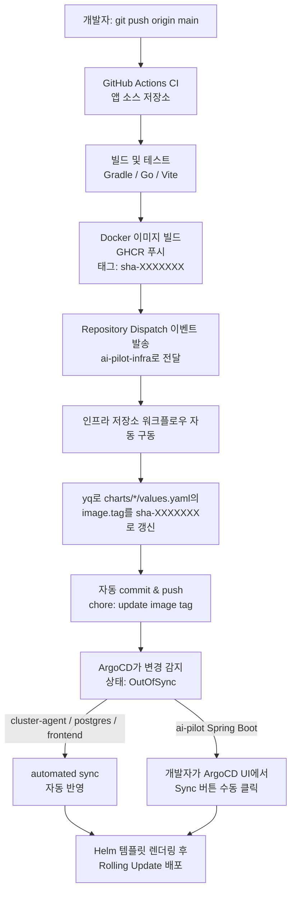

# AI-Pilot Infra

[ai-pilot](../ai-pilot) 애플리케이션을 위한 GitOps 기반 인프라 저장소입니다. k3s 홈랩 클러스터
위에서 ArgoCD를 통해 애플리케이션을 배포하고, Prometheus/Grafana/Loki로 관찰합니다.

## Cluster Overview

| 항목 | 내용 |
|---|---|
| Kubernetes | k3s (단일 노드, WSL2 기반) |
| GitOps 엔진 | ArgoCD |
| 패키지 관리 | Helm |
| Ingress | Traefik |
| 시크릿 관리 | External Secrets Operator + Azure Key Vault |
| 모니터링 | Prometheus, Grafana, Loki |
| 메시징 | NATS |
| 원격 접근 | Tailscale VPN |

## Repository Structure

```
ai-pilot-infra/
├── .github/workflows/   # 이미지 태그 자동 갱신 워크플로우
│   ├── update-backend-image-tag.yaml
│   ├── update-frontend-image-tag.yaml
│   └── update-go-agent-image-tag.yaml
├── bootstrap/           # 클러스터 최초 구축 시 1회성 설치 가이드 (k3s → Helm → ArgoCD)
├── applications/        # ArgoCD Application 매니페스트 (배포 대상 정의)
│   ├── cluster-agent.yaml
│   ├── frontend.yaml
│   └── postgres.yaml
├── charts/              # 컴포넌트별 Helm 차트
│   ├── ai-pilot/            # Spring Boot 백엔드
│   ├── ai-pilot-frontend/   # React 프론트엔드
│   └── cluster-agent/       # Go Cluster Agent
├── environments/        # 환경별(dev/prod) 공용 서비스 Helm values
│   └── dev/
│       ├── loki-values.yaml
│       ├── monitoring-values.yaml
│       ├── postgres-values.yaml
│       └── promtail-values.yaml
├── platform/            # 플랫폼 레벨 공통 리소스
│   ├── backup/           # DB 백업 CronJob
│   ├── nats/             # NATS 메시징
│   └── secrets/          # SecretStore, ExternalSecret
└── docs/                # 운영 문서 (runbooks, troubleshooting)
```

세 개의 애플리케이션 컴포넌트(backend, frontend, go-agent)는 각각 독립적인 이미지 태그 갱신
워크플로우를 가지고 있어, 한 컴포넌트만 변경되어도 다른 컴포넌트의 배포에 영향을 주지 않습니다.

## GitOps Flow

애플리케이션 코드가 푸시된 순간부터 실제 클러스터에 반영되기까지의 전체 흐름입니다.



**핵심 포인트**

- backend / frontend / go-agent 세 컴포넌트가 각각 독립된 CI 파이프라인과 이미지 태그 갱신
  워크플로우(`.github/workflows/update-*-image-tag.yaml`)를 가지고 있어, 한 컴포넌트만 변경돼도
  다른 컴포넌트의 배포에 영향을 주지 않습니다.
- 이미지 빌드부터 인프라 저장소의 `values.yaml` 갱신까지는 완전 자동화되어 있습니다
  (GitHub Actions의 Repository Dispatch로 두 저장소가 연결됨).
- **컴포넌트별 ArgoCD Sync 정책은 다음과 같이 다릅니다.**

  | 컴포넌트 | Application 정의 | Sync 정책 |
  |---|---|---|
  | cluster-agent | `applications/cluster-agent.yaml` (Git 관리) | `automated` (prune + selfHeal) |
  | postgres | `applications/postgres.yaml` (Git 관리) | `automated` (prune + selfHeal) |
  | frontend | `applications/frontend.yaml` (Git 관리) | `automated` |
  | ai-pilot (Spring Boot) | ArgoCD UI에서 직접 생성 (Git 미관리) | 수동 Sync |

  ai-pilot(Spring Boot)의 Application 리소스만 저장소에 선언적으로 존재하지 않고 ArgoCD UI로
  직접 생성되어 있어, 다른 컴포넌트와 달리 GitOps 관리 범위 밖에 있습니다. 이 부분을
  `applications/ai-pilot.yaml`로 코드화하고 auto-sync 여부를 결정하는 것이 향후 개선 과제입니다.
- 이미지 태그는 커밋 SHA(`sha-XXXXXXX`) 기준으로 관리되어, 배포된 버전과 소스 커밋을
  1:1로 추적할 수 있습니다.

## Runbooks & Troubleshooting

- 장애 대응 절차: [docs/runbooks](./docs/runbooks)
- 실제로 겪은 인프라 이슈 기록: [docs/troubleshooting](./docs/troubleshooting)

## Related Repository

애플리케이션 코드는 [ai-pilot](../ai-pilot) 저장소에서 관리합니다.
